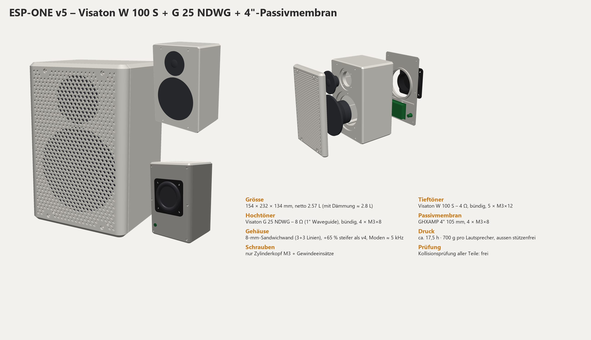
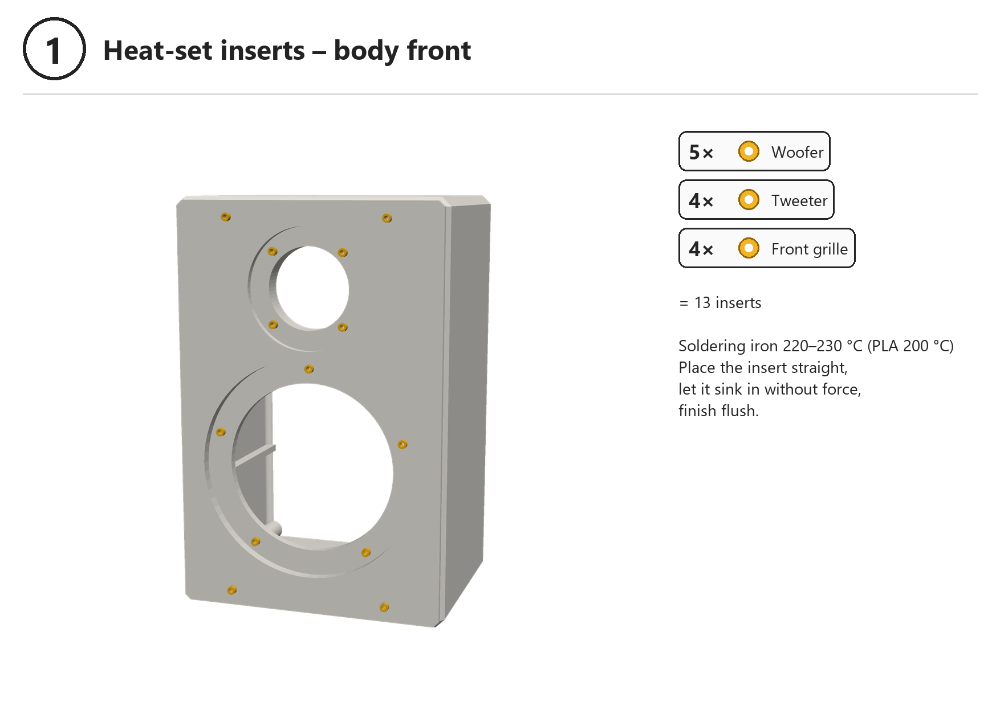
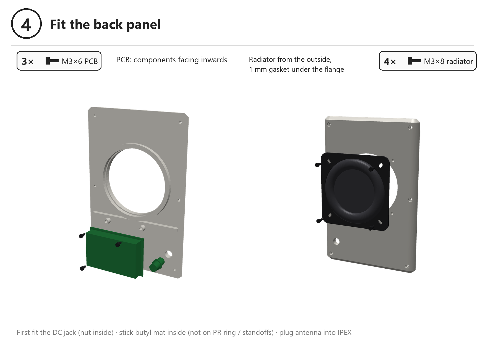
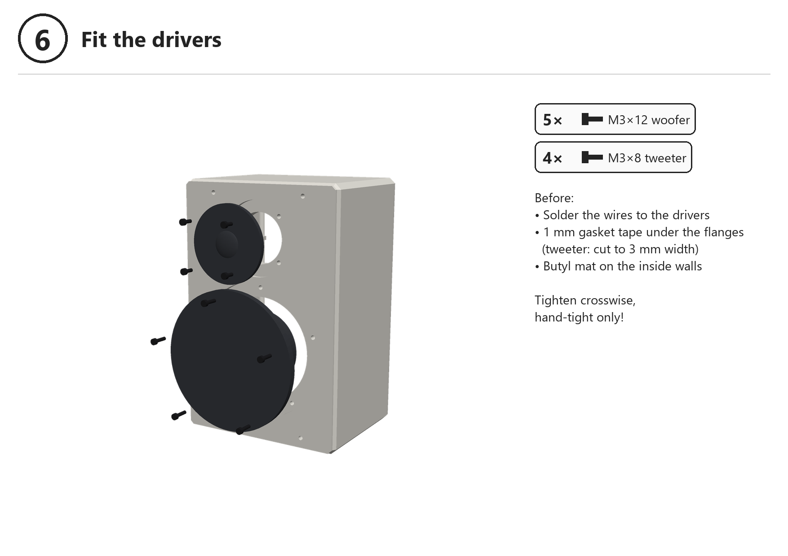
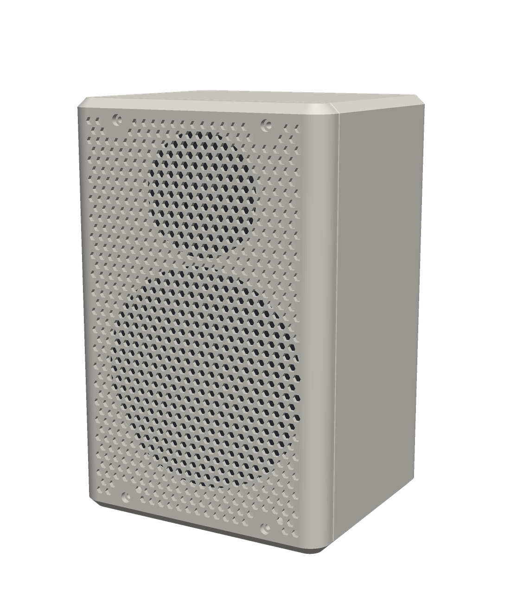
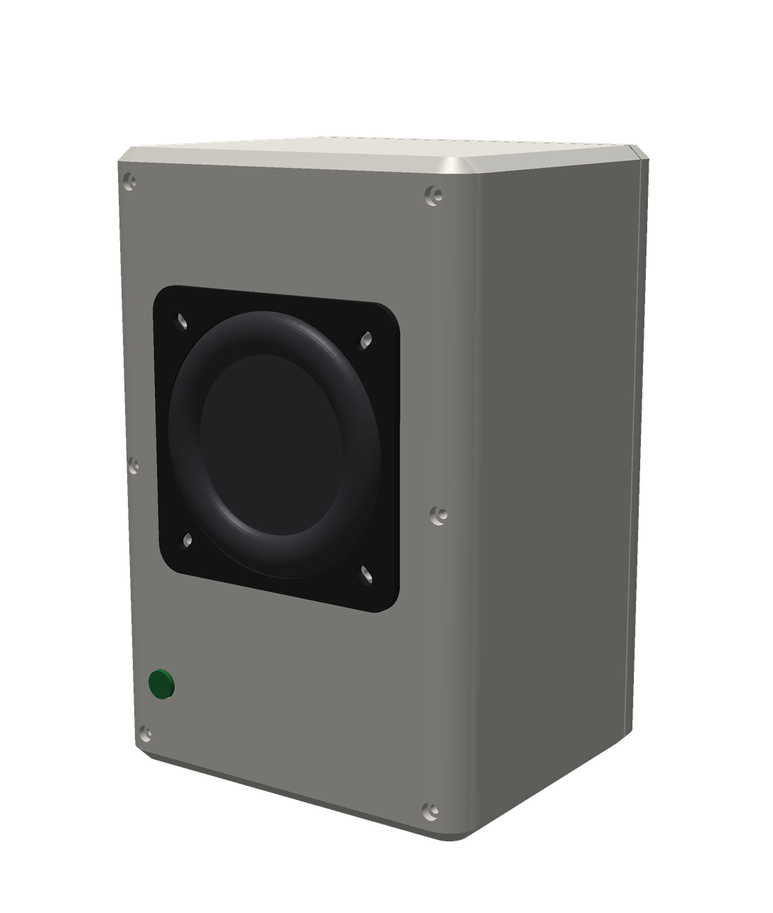
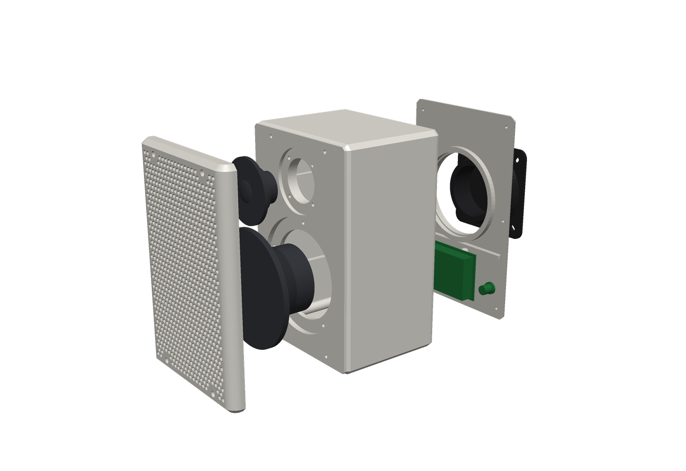
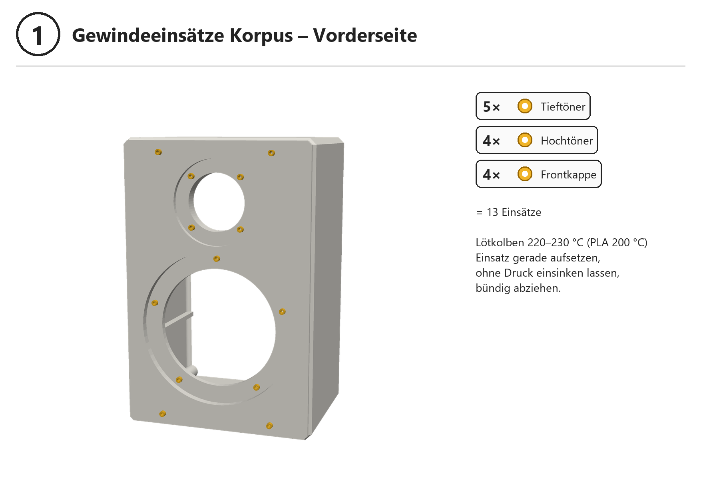
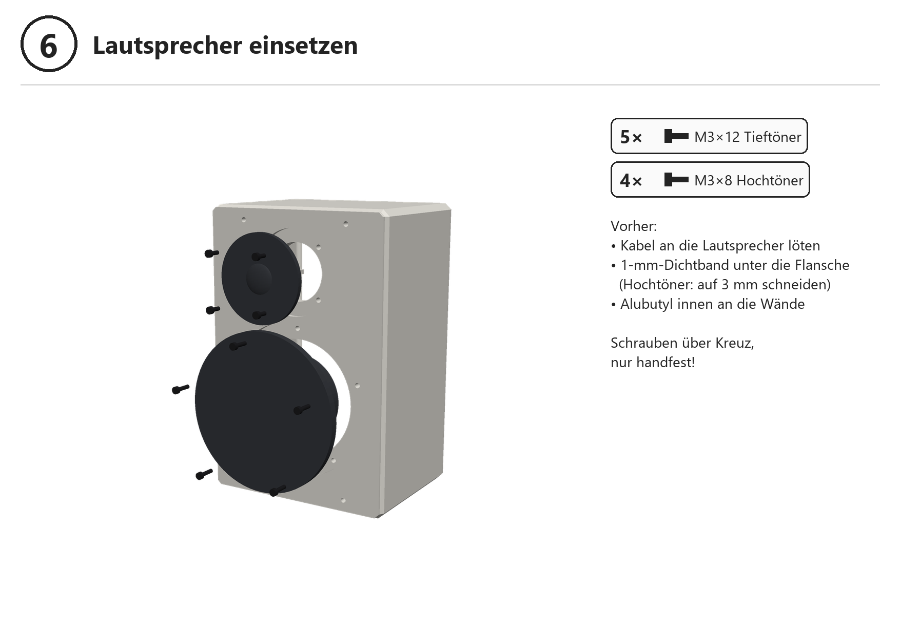
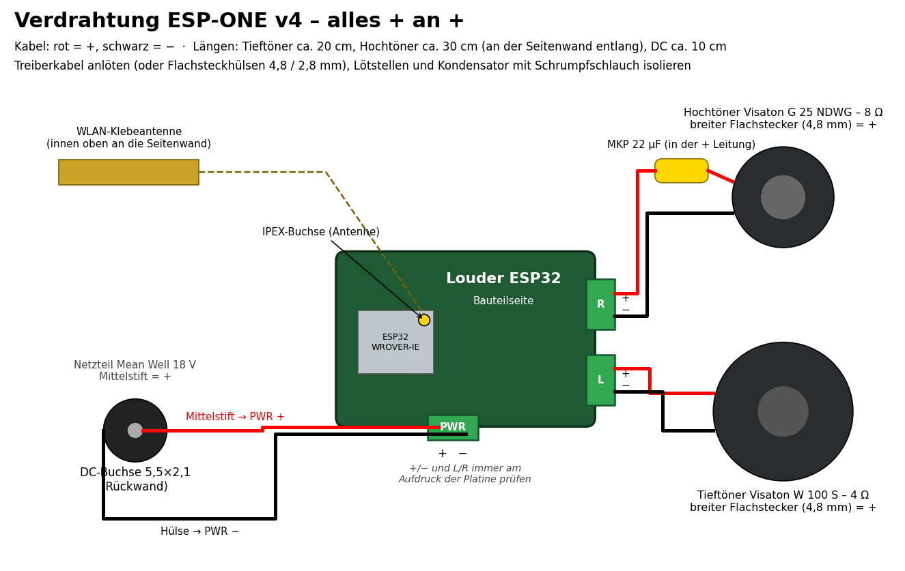

# ESP-ONE – DIY Wi-Fi Speaker with a 3D-Printed Enclosure

**[English](#english) · [Deutsch](#deutsch)**

> [!WARNING]
> **Untested design – the first prototype is still pending!**  
> **Ungetestetes Design – der erste Prototyp steht noch aus!**

### Repository layout

| Folder | Content |
|---|---|
| `druck/` | Print files (STL + sliced Bambu Studio projects) |
| `anleitung/` | Picture guides (English + German) |
| `bilder/` | Images |
| `cad/` | OpenSCAD model and tools |

File names are partly German: *Passprobe* = test-fit piece, *Korpus* = body, *Rueckwand* = back panel, *Frontkappe* = front grille.

---

## English

A compact 2-way Wi-Fi speaker with an ESP32 and a DSP amplifier in a fully 3D-printed enclosure. It has no buttons; you control it from your phone or through Home Assistant.

> **Note:** The DSP settings (crossover, EQ, excursion protection) will be added after the passive radiator has been measured. Until then, do not connect the tweeter (see below).

### Features

| | |
|---|---|
| Streaming | Spotify Connect, AirPlay (v1), multiroom via Music Assistant / Home Assistant (squeezelite-esp32) |
| Stereo | Two speakers can be used as a stereo pair (left/right) |
| Design | Active 2-way: 4" mid-woofer + 1" tweeter with waveguide + 4" passive radiator |
| Amplifier | TI TAS5805M with built-in DSP (crossover approx. 2.5 kHz, EQ, excursion protection) |
| Enclosure | 154 × 232 × 134 mm, 2.57 L net, 8 mm sandwich walls with ribs (wall resonances around 5 kHz) |
| Power | 18 V power supply, estimated standby approx. 0.6–1 W |
| Printing | 3 parts + test-fit piece, Bambu Lab P1S (256 mm build volume), no outside supports, approx. 17 h and 0.7 kg per speaker |
| Assembly | Only M3 socket head screws and M3 heat-set inserts; everything can be taken apart again |

### Parts

Full list (English + German): **[TEILELISTE.md](TEILELISTE.md)**

Main parts per speaker:
- Sonocotta **Louder ESP32**, ESP32-WROVER-N8R8 variant with external antenna (TAS5805M)
- **Visaton W 100 S – 4 Ω** (art. 9020), **Visaton G 25 NDWG – 8 Ω** (art. 1188)
- 4" passive radiator: frame 105 mm, cut-out 95 mm, hole circle 113 mm
- Power supply **Mean Well GST60A18-P1J**, MKP capacitor 22 µF
- 26 × heat-set insert M3 × L5 × OD4.5; M3 socket head screws: 6 × 10 mm, 9 × 12 mm, 8 × 8 mm, 3 × 6 mm

### Printing

| File | Orientation | Note |
|---|---|---|
| `druck/…/…1_Passprobe.3mf` | flat | **Print first**: checks cut-outs, hole patterns, PCB holes and a heat-set insert |
| `druck/…/…2_Korpus.3mf` (body) | front face down | Tree supports from the build plate only (only in the two driver recesses) |
| `druck/…/…3_Rueckwand.3mf` (back panel) | outer face down | no supports |
| `druck/…/…4_Frontkappe.3mf` (front grille) | visible face down | no supports |

- `druck/bambu_PLA/`: sliced projects for **Bambu PLA Basic**
- `druck/bambu_PETG/`: the same parts for **Bambu PETG HF**
- Both: P1S, 0.4 mm nozzle, textured PEI plate
- `druck/stl/`: plain STL files for other slicers

**Key settings** if you slice yourself:
- Body: 0.24 mm, **3 wall loops** (this turns the 8 mm wall into a stiff sandwich), 15 % gyroid
- Back panel: 0.24 mm, 15 % gyroid
- Grille and test-fit piece: 0.28 mm, 2 walls

Bambu Studio warns that the bed temperature is higher than the filament's softening temperature. That is normal for PLA and PETG: remove the top glass lid or leave the front door slightly open.

### Assembly

**Picture guide: [anleitung/PICTURE_GUIDE_EN.pdf](anleitung/PICTURE_GUIDE_EN.pdf)**: 10 pages, all heat-set inserts marked directly from the CAD model. (German version: [BILDANLEITUNG.pdf](anleitung/BILDANLEITUNG.pdf))

| | | |
|---|---|---|
|  |  |  |

Wiring (always + to +; the capacitor goes into the tweeter's plus lead):

### Firmware

- Flash the Louder ESP32 with **squeezelite-esp32** (Sonocotta web installer).
- Board configuration: `model=I2S,bck=26,ws=25,do=22,sda=21,scl=27,i2c=45`
- The DSP settings for the TAS5805M go into squeezelite's NVS editor as `dac_controlset` (JSON). They will be created after the passive radiator has been measured and added here.

> ⚠ **Do not connect the tweeter until the DSP settings are loaded.** Without the crossover it receives bass and can be damaged despite the capacitor. A first test works with the woofer only.

### CAD

- `cad/espone.scad`: parametric OpenSCAD model (body, back panel, front grille, test-fit piece). Select the part with `part = "body" | "back" | "cap" | "testfit" | "preview"`.
- `cad/kollisionspruefung.scad`: intersects the parts pairwise; an empty result means no collision. Set `part = "none"` in `espone.scad` first.
- `cad/render.py`: simple renderer for preview images from STL files (Python, numpy, Pillow).

| Front | Back | Exploded view |
|---|---|---|
|  |  |  |

### Repository layout

| Folder | Content |
|---|---|
| `druck/` | Print files (STL + sliced Bambu Studio projects) |
| `anleitung/` | Picture guides (English + German) |
| `bilder/` | Images |
| `cad/` | OpenSCAD model and tools |

File names are partly German: *Passprobe* = test-fit piece, *Korpus* = body, *Rueckwand* = back panel, *Frontkappe* = front grille.

---

## Deutsch

Kompakter 2-Weg-WLAN-Lautsprecher mit ESP32 und DSP-Verstärker, Gehäuse komplett 3D-gedruckt. Ohne Tasten am Gerät, bedient wird er nur übers Handy bzw. über Home Assistant.

> **Hinweis:** Die DSP-Einstellung (Frequenzweiche, EQ, Hubschutz) wird nach der Messung der Passivmembran ergänzt. Bis dahin den Hochtöner nicht anschliessen (siehe unten).

### Eigenschaften

| | |
|---|---|
| Streaming | Spotify Connect, AirPlay (v1), Multiroom über Music Assistant / Home Assistant (squeezelite-esp32) |
| Stereo | Zwei Lautsprecher als Stereopaar (links/rechts) möglich |
| Prinzip | 2-Weg aktiv: 4"-Tiefmitteltöner + 1"-Hochtöner mit Waveguide + 4"-Passivmembran |
| Verstärker | TI TAS5805M mit eingebautem DSP (Frequenzweiche ca. 2,5 kHz, EQ, Hubschutz) |
| Gehäuse | 154 × 232 × 134 mm, netto 2,57 L, 8-mm-Sandwichwände mit Rippen (Wandresonanzen um 5 kHz) |
| Strom | 18-V-Netzteil, Standby geschätzt ca. 0,6–1 W |
| Druck | 3 Teile + Passprobe, Bambu Lab P1S (256 mm Bauraum), aussen ohne Stützen, ca. 17 h und 0,7 kg pro Lautsprecher |
| Montage | nur M3-Zylinderkopfschrauben und M3-Gewindeeinsätze, alles wieder zerlegbar |

### Teile

Vollständige Liste (Englisch + Deutsch): **[TEILELISTE.md](TEILELISTE.md)**

Hauptteile pro Lautsprecher:
- Sonocotta **Louder ESP32**, Variante ESP32-WROVER-N8R8 mit externer Antenne (TAS5805M)
- **Visaton W 100 S – 4 Ω** (Art. 9020), **Visaton G 25 NDWG – 8 Ω** (Art. 1188)
- 4"-Passivmembran, Rahmen 105 mm, Ausschnitt 95 mm, Lochkreis 113 mm
- Netzteil **Mean Well GST60A18-P1J**, MKP-Kondensator 22 µF
- 26 × Gewindeeinsatz M3 × L5 × OD4,5; M3-Zylinderkopf: 6 × 10 mm, 9 × 12 mm, 8 × 8 mm, 3 × 6 mm

### Drucken

| Datei | Lage auf dem Bett | Hinweis |
|---|---|---|
| `druck/…/…1_Passprobe.3mf` | flach | **zuerst drucken**: prüft Ausschnitte, Lochbilder, Platinenlöcher, Gewindeeinsatz |
| `druck/…/…2_Korpus.3mf` | Front nach unten | Baumstützen nur ab Druckbett (nur in den zwei Lautsprecher-Taschen) |
| `druck/…/…3_Rueckwand.3mf` | Aussenseite nach unten | ohne Stützen |
| `druck/…/…4_Frontkappe.3mf` | Sichtseite nach unten | ohne Stützen |

- `druck/bambu_PLA/`: fertig geslicte Projekte für **Bambu PLA Basic**
- `druck/bambu_PETG/`: dieselben Teile für **Bambu PETG HF**
- Beide Varianten: P1S, 0,4-mm-Düse, Texture-PEI-Platte
- `druck/stl/`: die nackten STL-Dateien für andere Slicer

**Wichtige Einstellungen**, wenn du selbst slicest:
- Korpus: 0,24 mm, **3 Wandlinien** (die 8-mm-Wand wird so zum steifen Sandwich), 15 % Gyroid
- Rückwand: 0,24 mm, 15 % Gyroid
- Kappe und Passprobe: 0,28 mm, 2 Wände

Bambu Studio warnt „Betttemperatur höher als Erweichungstemperatur“. Das ist bei PLA und PETG normal: Glasdeckel ab oder Fronttür einen Spalt offen lassen.

### Montage

**Bildanleitung: [anleitung/BILDANLEITUNG.pdf](anleitung/BILDANLEITUNG.pdf)**: 10 Seiten, alle Gewindeeinsätze direkt aus dem CAD markiert. (Englisch: [PICTURE_GUIDE_EN.pdf](anleitung/PICTURE_GUIDE_EN.pdf))

| | | |
|---|---|---|
|  |  |  |

Verdrahtung (alles + an +, der Kondensator kommt in die Plus-Leitung des Hochtöners):

### Firmware

- Louder ESP32 mit **squeezelite-esp32** flashen (Web-Installer von Sonocotta).
- Board-Konfiguration: `model=I2S,bck=26,ws=25,do=22,sda=21,scl=27,i2c=45`
- Die DSP-Einstellung für den TAS5805M kommt als `dac_controlset` (JSON) in den NVS-Editor von squeezelite. Sie wird nach der Messung der Passivmembran erstellt und hier ergänzt.

> ⚠ **Hochtöner erst anschliessen, wenn die DSP-Einstellung geladen ist.** Ohne Frequenzweiche bekommt er Bass und kann trotz Kondensator beschädigt werden. Ein erster Test geht nur mit dem Tieftöner.

### CAD

- `cad/espone.scad`: parametrisches OpenSCAD-Modell (Korpus, Rückwand, Frontkappe, Passprobe). Teil wählen mit `part = "body" | "back" | "cap" | "testfit" | "preview"`.
- `cad/kollisionspruefung.scad`: schneidet die Teile paarweise, ein leeres Ergebnis heisst kollisionsfrei. Dafür in `espone.scad` `part = "none"` setzen.
- `cad/render.py`: einfacher Renderer für Vorschaubilder aus STL-Dateien (Python, numpy, Pillow).

| Front | Rückseite | Explosion |
|---|---|---|
|  |  |  |

### Ordner

| Ordner | Inhalt |
|---|---|
| `druck/` | Druckdateien (STL + geslicte Bambu-Studio-Projekte) |
| `anleitung/` | Bildanleitungen (Englisch + Deutsch) |
| `bilder/` | Bilder |
| `cad/` | OpenSCAD-Modell und Werkzeuge |
